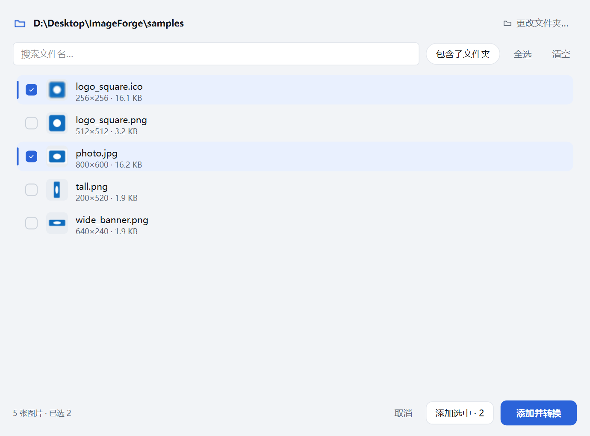

# ImageForge 2.0

把 PNG / JPG / WebP / BMP / GIF / TIFF / AVIF 互转，并且一键生成**多尺寸 Windows 图标**的桌面小工具。

界面用 PySide6（Qt 6）重写：原生控件、明暗两套主题、1.5× 高 DPI 下依然锐利。
转换全部在本机完成，不依赖浏览器、不上传文件、不需要联网。

**[下载发布版](https://github.com/kuangdang123/ImageForge/releases/latest)** —— 单个 `ImageForge.exe`，不需要装 Python。


<details>
<summary>深色主题、挑图窗口、预览窗口、转换完成（点击展开）</summary>





</details>

## 功能

- **多尺寸 ICO**：一次输出 16 / 24 / 32 / 48 / 64 / 128 / 256 七档，每档独立重采样，不是把一张大图塞进去。
- **常用格式互转**：PNG、JPG、WebP、BMP、GIF、TIFF、AVIF 任意方向。
- **文件夹里挑图**：「选择文件夹…」打开图片列表，搜索、全选、Shift 连选，只把想要的几张加进队列。
- **批处理**：拖入文件或文件夹、粘贴剪贴板图片、递归扫描子目录、保留目录结构。
- **可控输出**：有损质量滑杆、WebP 无损、保留 EXIF / ICC、文件名后缀、输出到源文件旁边或指定文件夹。
- **不覆盖原图**：输出与源文件同名时自动改名，重名自动加 ` (2)`。
- **预览**：大图查看 + 透明棋盘格 + 元信息；输出 ICO 时还能看到每一档尺寸真实渲染出来的样子。
- **明暗主题**、窗口大小、上次使用的目录都会记住；重复启动只会开一个窗口。

## 快速开始

### 方式一：下载现成的 exe（不需要 Python）

从 [Releases](https://github.com/kuangdang123/ImageForge/releases/latest) 下载 `ImageForge.exe`（约 52 MB），放到任意文件夹双击即可。单文件、免安装，第一次启动会先解压到临时目录，慢一两秒。

重复双击不会再开第二个窗口，而是把已经开着的窗口提到前面来。

### 方式二：从源码运行

环境：Windows 10/11，Python 3.10 及以上。

```powershell
cd D:\Desktop\ImageForge
pip install -r requirements.txt
```

然后任选一种方式启动：

| 方式 | 命令 |
| --- | --- |
| 双击启动器 | `启动 ImageForge 2.0.bat` |
| 无控制台窗口 | `pythonw app2.pyw` |
| 控制台 | `python app2.pyw` |
| 模块入口 | `python -m imgforge.qt` |

启动器会优先找同目录下的 `ImageForge.exe`，没有才退回 `pythonw` / `pyw` / `python`。

> 1.x 的 tkinter 版本仍然保留在标签 `v1.0.0` 与 `app.pyw` / `启动 ImageForge.bat` 里，可以继续用；2.0 是独立的 `app2.pyw` 与 `imgforge/qt/`。

## 使用

左侧是待处理列表，右侧是输出设置，底栏负责「保存到哪」和「开始转换」。

1. 拖入图片，或用工具栏添加 / `Ctrl+V` 粘贴；
2. 在右侧选输出格式。选 **ICO** 时还会出现尺寸、非正方形处理、像素数据三组选项；
3. 选保存位置（源文件旁 / 指定文件夹）；
4. `Ctrl+Enter` 或点「开始转换」。

### 从文件夹里挑图

点「选择文件夹…」（或 `Ctrl+Shift+O`）会打开图片列表，而不是把所有图一股脑塞进队列：


- 顶部显示当前文件夹，可以「更改文件夹…」或「刷新」；
- 搜索框按文件名过滤，多个词用空格分隔；
- 勾选、Shift 连选、「全选」「清空」，双击某一行只添加这一张；
- 已经在队列里的图会标「已在列表」并置灰，不会重复添加；
- 「添加选中 · N」只入队，「添加并转换」在探测完成后自动开始转换。

快捷键：

| 键 | 作用 |
| --- | --- |
| `Ctrl+O` | 添加图片 |
| `Ctrl+Shift+O` | 打开文件夹挑图（多选） |
| `Ctrl+V` | 粘贴剪贴板里的图片或文件路径 |
| `Delete` | 从列表移除选中项 |
| `Ctrl+Enter` | 开始转换 |
| `Enter` | 预览选中项 |
| `Esc` | 取消转换 |
| `↑` / `↓` | 在列表里移动 |

挑图窗口里另有一套键：`↑` `↓` 移动、`空格` 勾选、`Ctrl+A` 全选、`Enter` 添加、`Ctrl+Enter` 添加并转换、`Esc` 关闭。

## 命令行

不想开窗口时可以直接用（命令行不依赖 Qt，装在无图形界面的机器上也能跑）：

```powershell
python -m imgforge formats
python -m imgforge info samples\wide_banner.png
python -m imgforge convert samples -t ico -o out
python -m imgforge convert samples\logo_square.png -t jpg -q 92
```

实际输出：

```text
$ python -m imgforge convert samples -t ico -o tmp\cli_out --sizes 16,24,32,48,64,128,256
源文件           尺寸     输出大小  输出文件         备注
───────────────  ───────  ────────  ───────────────  ────
logo_square.png  256×256  16.1 KB   logo_square.ico  完成
photo.jpg        256×256  18.4 KB   photo.ico        完成
tall.png         256×256  10.6 KB   tall.ico         完成
wide_banner.png  256×256  10.4 KB   wide_banner.ico  完成

全部完成：4 个文件 → ICO（输出到 tmp\cli_out）
```

常用参数：

| 参数 | 说明 |
| --- | --- |
| `-t, --target` | 输出格式，默认 `ico` |
| `-o, --output` | 输出文件夹，默认与源文件同目录 |
| `--sizes` | ICO 尺寸，逗号分隔 |
| `--fit` | 非正方形处理：`contain`（留白）/ `fill`（裁切）/ `stretch`（拉伸） |
| `--payload` | ICO 像素数据：`png`（新系统）或 `bmp`（老系统兼容） |
| `--no-upscale` | 不放大，跳过比源图更大的尺寸 |
| `-q, --quality` | 有损格式质量 1–100 |
| `--lossless` | WebP 无损 |
| `--suffix` / `--overwrite` | 文件名后缀 / 允许覆盖 |
| `--keep-tree` / `--base` | 保留输入目录结构 |
| `--no-recursive` / `--no-metadata` | 不递归 / 不保留 EXIF、ICC |
| `--dry-run` | 只打印计划，不写文件 |

有文件失败时进程返回码为 `1`，方便脚本判断。

## 关于 ICO

Windows 图标不是「一张 256×256 的 PNG」那么简单：任务栏、标题栏、文件列表用的尺寸各不相同，系统会按需挑最接近的一档，没有就自己缩——通常比我们预先做好的模糊。

本项目的做法：

- **每个尺寸单独渲染**：LANCZOS 从原图分别缩到 16/24/32/48/64/128/256，而不是从大往小逐级缩；
- **非正方形**：`留白`（透明居中）、`填充裁切`（居中裁掉多余）、`拉伸` 三选一；
- **像素数据**：`PNG 压缩` 体积小、Windows Vista 及以上都认；`BMP 兼容` 是传统 DIB + AND 掩码，兼容老工具，体积大一些；
- **允许放大**：默认关闭时，比源图还大的档位会被跳过（例如 64×64 的源图只出 16/24/32/48/64）。

为什么不用 Pillow 自带的 ICO 保存？它的实现会对帧做 `thumbnail()`，可能产出非正方形帧，并且直接跳过比源图大的尺寸，也没法控制留白方式。所以 `imgforge/ico.py` 自己写了容器编码，并用 Win32 `LoadImage(..., IMAGE_ICON)` 在 16/32/48/256 各档实际加载验证过（PNG 与 BMP 两种载荷都能拿到有效句柄）。

## 支持格式

| 目标 | 扩展名 | 透明 | 动图 | 说明 |
| --- | --- | --- | --- | --- |
| ICO | `.ico` | ✓ | | 图标，多尺寸 |
| PNG | `.png` | ✓ | | 无损，体积中等 |
| JPG | `.jpg` | | | 有损，照片首选 |
| WebP | `.webp` | ✓ | ✓ | 高压缩，可无损 |
| BMP | `.bmp` | | | 无压缩，兼容老系统 |
| GIF | `.gif` | ✓ | ✓ | 256 色 |
| TIFF | `.tiff` | ✓ | | LZW 压缩，印刷常用 |
| AVIF | `.avif` | ✓ | | 新格式，压缩率高但较慢 |

输入除了上面这些，还认 `.jpeg .jfif .jpe .dib .tif .tga .ppm .pgm .pbm`。

说明：

- 目标格式不支持透明时（JPG / BMP），透明区域会按设定背景色压平，默认白色；
- 动图转成静态格式时只保留第一帧，并在这行状态里给出提示；
- 动图转 WebP / GIF 会保留所有帧。

## 设置保存在哪

`%APPDATA%\ImageForge\settings.json` —— 主题、上次的输出格式、质量、ICO 选项、窗口大小、上次目录等。删掉它就恢复默认。

转换产物不会写进程序目录，只有你指定的输出路径。

## 项目结构

```text
ImageForge/
├─ app2.pyw                  2.0 桌面入口（PySide6）
├─ 启动 ImageForge 2.0.bat   2.0 启动器
├─ app.pyw / 启动 ImageForge.bat   1.x（tkinter）入口
├─ requirements.txt
├─ imgforge/
│  ├─ qt/                    2.0 界面（PySide6）
│  │  ├─ app.py              QApplication、主题、单实例
│  │  ├─ mainwindow.py       主窗口：命令栏 / 队列 / 设置 / 底栏
│  │  ├─ queueview.py        文件队列模型、委托、拖放
│  │  ├─ settings_panel.py   输出设置面板
│  │  ├─ preview.py          预览窗口与 ICO 尺寸条
│  │  ├─ picker.py           从文件夹挑图
│  │  ├─ tokens.py           颜色 / 间距 / 字号 token
│  │  ├─ theme.py            主题、QSS、明暗切换
│  │  ├─ widgets.py          卡片、胶囊、分段选择、开关、Toast…
│  │  └─ icons.py            矢量图标
│  ├─ converter.py           格式表、单文件转换、批量任务
│  ├─ ico.py                 ICO 渲染与容器编码
│  ├─ settings.py            设置读写
│  ├─ single_instance.py     互斥体 + 激活已开窗口
│  ├─ cli.py                 命令行
│  ├─ __main__.py            模块入口（无参数开 GUI）
│  ├─ gui.py / widgets.py / theme.py / picker.py   1.x tkinter 界面
│  └─ assets/                应用图标与 logo
├─ samples/                  示例图片
├─ tests/                    35 个单元测试（格式转换 + 挑图 + 单实例）
├─ tools/
│  ├─ make_icon.py           从 assets/logo.png 重新生成 assets/app.ico
│  ├─ check_contrast.py      色板对比度校验
│  ├─ build_exe.py           PyInstaller 打包（默认 Qt 版，--legacy-tk 打 1.x）
│  ├─ entry_qt.py / entry_gui.py        exe 入口脚本
│  ├─ qt_smoke.py            离屏冒烟：添加 → 转换 → 预览 → 挑图
│  ├─ qt_shot.py             真实平台界面截图
│  ├─ shot_window.py         按标题截取任意窗口（含打包后的 exe）
│  ├─ gui_smoke.py / picker_smoke.py   1.x 界面冒烟
│  └─ …
└─ docs/screenshots/
```

## 开发

```powershell
python -m unittest discover -s tests          # 35 个测试
python tools/make_icon.py                     # 从 assets/logo.png 生成多尺寸 app.ico
python tools/check_contrast.py                # 明暗两套色板 WCAG 校验
python tools/qt_smoke.py                      # 离屏跑完整流程
python tools/qt_shot.py light tmp\a.png       # 真实窗口截图（dark / --picker / --preview / --convert）
python tools/build_exe.py                     # 打包 dist\ImageForge.exe（约 52 MB）
```

开发脚本把配置写到 `tmp/settings/`（通过 `IMAGEFORGE_HOME` 环境变量重定向），不会动 `%APPDATA%` 里的真实配置。

## 常见问题

**转成 JPG 后透明背景变白了？** JPG 不支持透明，透明区域会按背景色压平，这是预期行为。要保留透明就选 PNG / WebP / AVIF。

**输出的文件名多了 ` (2)`？** 避免覆盖已有文件。源文件和输出同名时也会自动改成 `名字_格式.扩展名`。

**拖拽没反应？** 2.0 的拖拽由 Qt 直接处理，不依赖额外组件。如果确实没反应，用工具栏的「添加图片」「选择文件夹…」一样可以。

**双击 exe 时 Windows 提示"已保护你的电脑"？** 程序没有代码签名，首次运行会触发 SmartScreen。点「更多信息」→「仍要运行」即可；也可以右键 exe → 属性 → 常规 → 勾选「解除锁定」。

**已经开着一个窗口，再双击好像没反应？** 这是单实例行为：新进程会把已经开着的窗口提到前台，然后自己退出，避免开出一堆重复窗口。

**挑图时有些行是灰的、右边写着「已在列表」？** 这些图已经在待处理队列里了，重复勾选不会重复添加。

**动图不动了？** 只有 WebP 和 GIF 作为输出格式才支持动图，其它格式只取第一帧。

**为什么 AVIF 慢？** 编码本身计算量大，批量时耐心等一下；急着用可以先转 WebP。

**打包后的 exe 是 52 MB？** PySide6 自带的 Qt 运行库体积就在这里；已经排除了 WebEngine、QML、3D 等用不到的大模块。1.x 的 tkinter 版本只有 23 MB。
