# ImageForge 2.7.0

把 PNG / JPG / WebP / BMP / TIFF / AVIF 互转、一键生成**多尺寸 Windows 图标**，把图片**放大 2–32 倍**（Real-CUGAN Vulkan / APISR DirectML），还能把视频在 **MP4 / MKV / MOV / WebM / AVI / GIF** 之间互转的桌面小工具；另外提供**零安装的 Web 版**（`web/index.html`，浏览器本地处理、不联网）。

界面用 PySide6（Qt 6）编写：原生控件、明暗两套主题、1.5× 高 DPI 下依然锐利；顶部导航切换「图片转换」「视频转换」「分辨率放大」，三页共用同一套主题、拖拽与队列交互。所有偏好（模式、格式、尺寸、质量、模型、主题、窗口大小）下次启动自动恢复。
所有处理都在本机完成，不依赖浏览器、不上传文件、不需要联网（模型首次下载除外）。

**[下载发布版](https://github.com/kuangdang123/ImageForge/releases/latest)** —— 单个 `ImageForge.exe`，不需要装 Python。

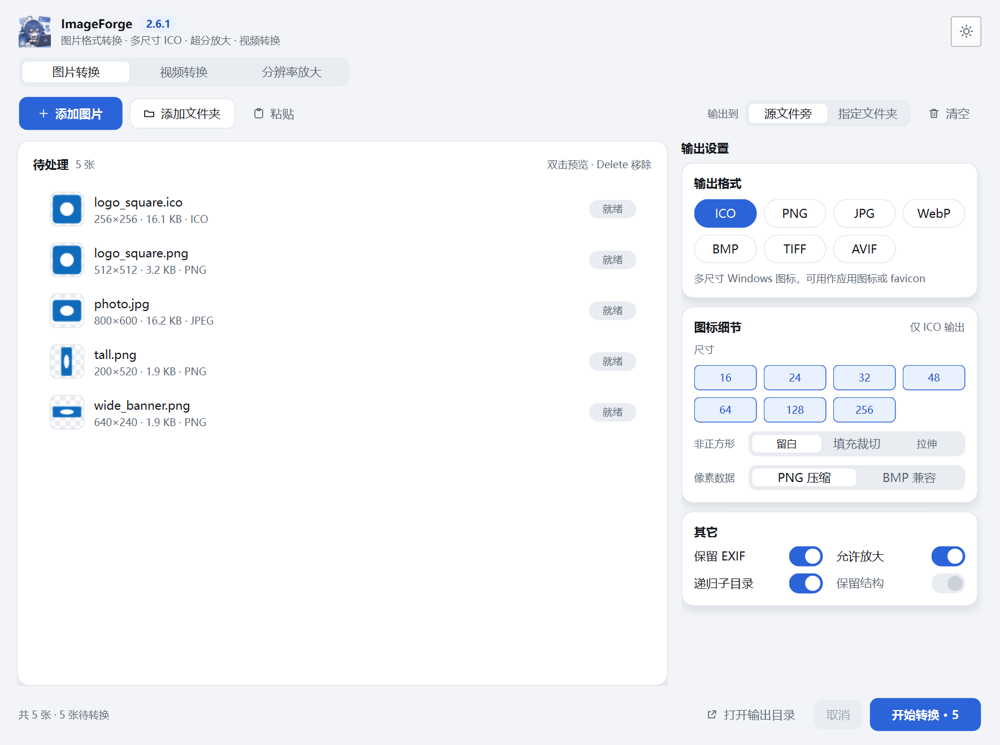

<details>
<summary>深色主题、分辨率放大、转换完成、挑图窗口、预览窗口（点击展开）</summary>

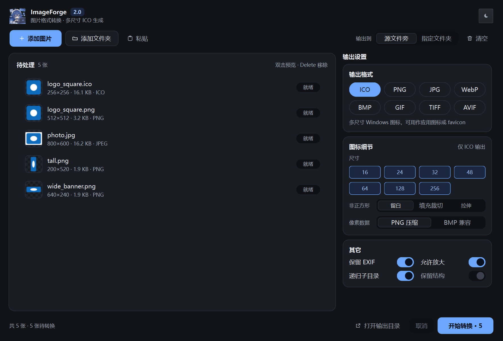

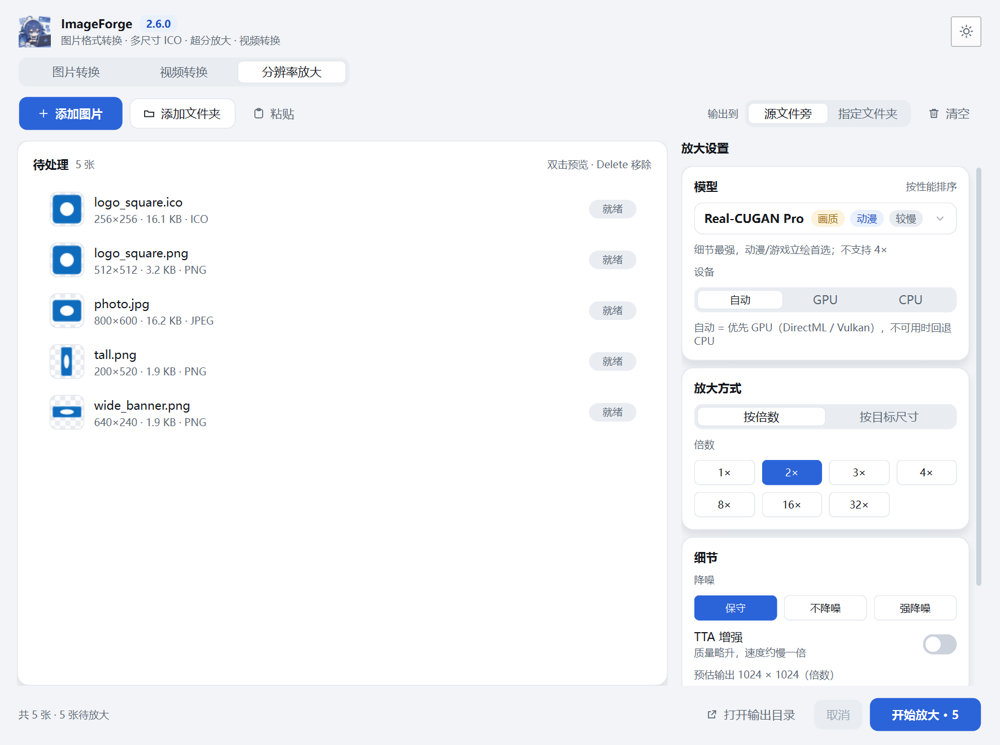

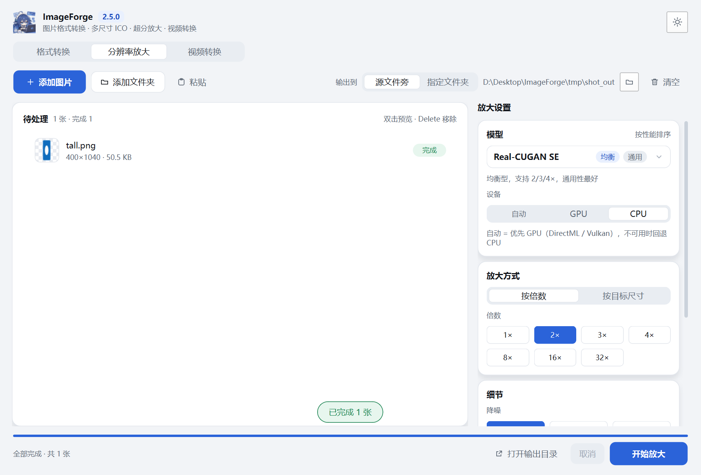

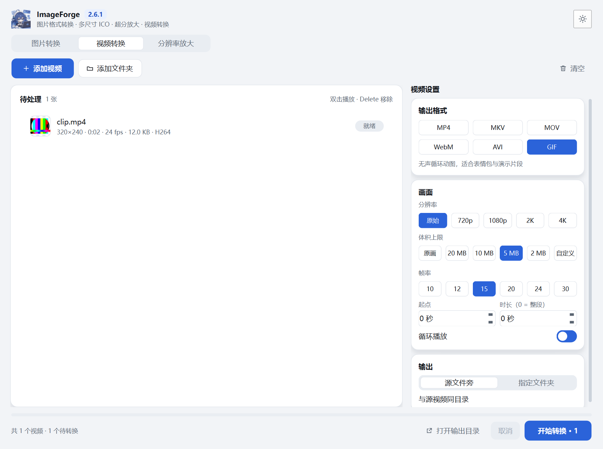

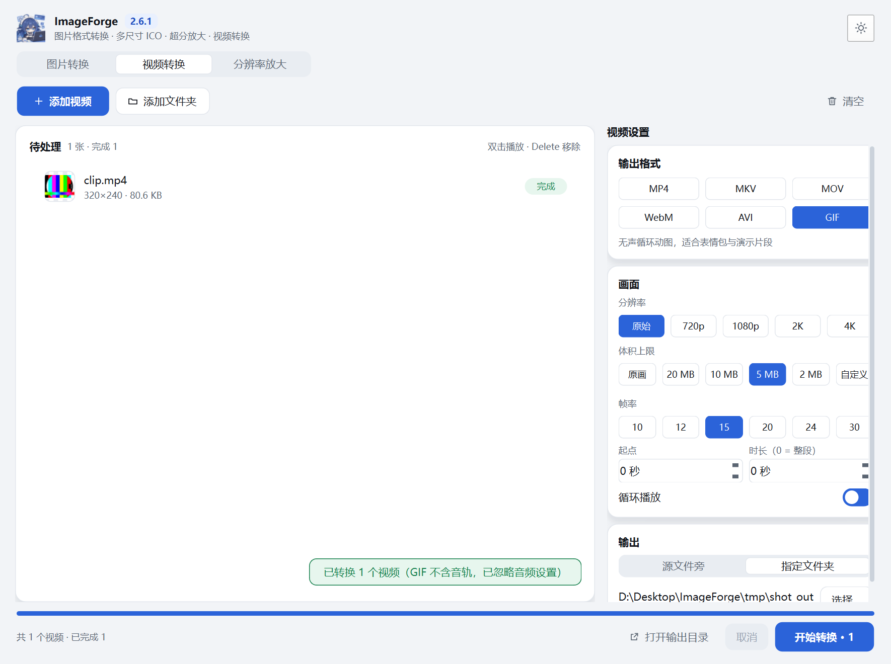


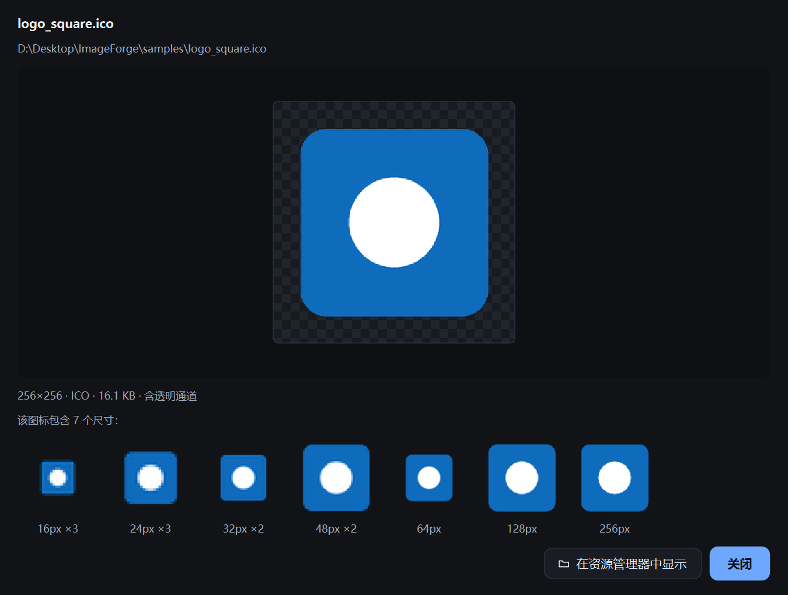

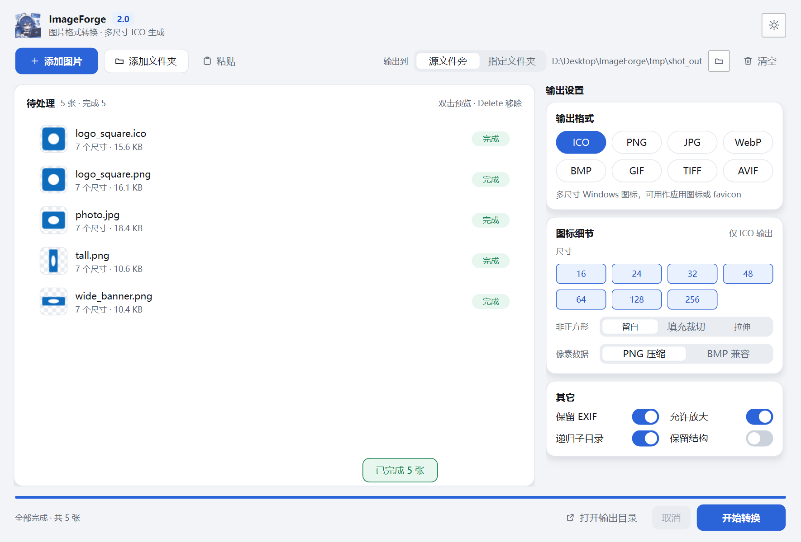

</details>

## 功能

- **多尺寸 ICO**：一次输出 16 / 24 / 32 / 48 / 64 / 128 / 256 七档，每档独立重采样，不是把一张大图塞进去。
- **图片格式互转**：PNG、JPG、WebP、BMP、TIFF、AVIF 任意方向；GIF 仍可作为输入（转成静态格式或 WebP 动图），但不再作为图片输出格式。
- **分辨率放大**：两套模型共 6 档，模型下拉按性能排序、每项带彩色短标签（画质 / 动漫 / 均衡 / 最快 / 轻量）方便一眼挑：
  - **Real-CUGAN**（ncnn + Vulkan）：Pro（细节最强）/ SE（均衡通用）/ NoSE（最快最轻）——免显卡、CPU 也能跑；
  - **APISR**（ONNX + DirectML GPU）：GRL（超轻量最快）/ RRDB（CVPR 2024 论文主模型）/ DAT（画质最好）——面向动画截图，GPU 上比 CPU 快 5–9 倍，固定 4× 输出。
  支持按倍数（`1×`–`32×`，8× 及以上由多轮模型组合）或按目标尺寸（720p / 1080p / 2K / 4K / 8K / 自定义）放大；设备默认 `自动`（优先 GPU，不可用时回退 CPU）。模型按需下载，不占 exe 体积。
- **视频转换**：顶部「视频转换」页把 MP4 / MKV / MOV / WebM / AVI / GIF 互转，可改分辨率、帧率、截取片段；视频导 GIF 支持帧率、起点、时长与循环，需要系统里装好 ffmpeg。
- **文件夹里挑图**：「选择文件夹…」打开图片列表，搜索、全选、Shift 连选，只把想要的几张加进队列。
- **批处理**：拖入文件或文件夹、粘贴剪贴板图片、递归扫描子目录、保留目录结构。
- **可控输出**：有损质量滑杆、WebP 无损、保留 EXIF / ICC、文件名后缀、输出到源文件旁边或指定文件夹；放大页还能选择保持原格式或另存 PNG / JPG / WebP。
- **不覆盖原图**：输出与源文件同名时自动改名，重名自动加 ` (2)`；放大产物默认带 `_upscaled`，绝不碰源文件。
- **预览**：大图查看 + 透明棋盘格 + 元信息；输出 ICO 时还能看到每一档尺寸真实渲染出来的样子。
- **Web 版**：同一套功能搬到浏览器里（`web/index.html`），零安装、零依赖、文件不离开本机；ICO / BMP / TIFF / ZIP 编码器都是手写的，WebP / AVIF 编码取决于浏览器。
- **明暗主题**、窗口大小、上次使用的目录都会记住；重复启动只会开一个窗口。

## 快速开始

### 方式一：下载现成的 exe（不需要 Python）

从 [Releases](https://github.com/kuangdang123/ImageForge/releases/latest) 下载 `ImageForge.exe`（约 87 MB），放到任意文件夹双击即可。单文件、免安装，第一次启动会先解压到临时目录，慢一两秒。

> 2.3.0 起超分模型不再塞进 exe：第一次切到「分辨率放大」时，右侧卡片会让你点「下载模型」（约 44 MB，一次安装离线可用）；也可以下载 [`realcugan-ncnn-models.zip`](https://github.com/kuangdang123/ImageForge/releases/download/models-v1/realcugan-ncnn-models.zip) 后点「从文件安装…」。只做格式转换的话完全不需要模型。

重复双击不会再开第二个窗口，而是把已经开着的窗口提到前面来。

> 视频转换需要系统里有 **ffmpeg**。Windows 一句命令就能装：`winget install Gyan.FFmpeg`；装完不用重启，在视频页点「重新检测」或重开程序即可。只做图片功能的话完全不需要 ffmpeg。

### 方式二：从源码运行

环境：Windows 10/11，Python 3.10 及以上。

```powershell
cd D:\Desktop\ImageForge
pip install -r requirements.txt
```

然后任选一种方式启动：

| 方式 | 命令 |
| --- | --- |
| 双击启动器 | `启动 ImageForge 2.0.bat` |
| 无控制台窗口 | `pythonw app2.pyw` |
| 控制台 | `python app2.pyw` |
| 模块入口 | `python -m imgforge.qt` |

启动器会优先找同目录下的 `ImageForge.exe`，没有才退回 `pythonw` / `pyw` / `python`。

> 1.x 的 tkinter 版本仍然保留在标签 `v1.0.0` 与 `app.pyw` / `启动 ImageForge 1.x.bat` 里，可以继续用；2.0 是独立的 `app2.pyw` 与 `imgforge/qt/`。

### 方式三：Web 版（不用装任何东西）

双击仓库里的 `web/index.html` 就能用：单个静态页面，不需要 Python、不需要安装、不联网。
支持图片格式互转与多尺寸 ICO，细节见 [Web 版](#web-版)。

## 使用

左侧是待处理列表，右侧是输出设置，底栏负责「保存到哪」和「开始转换」。

1. 拖入图片，或用工具栏添加 / `Ctrl+V` 粘贴；
2. 在右侧选输出格式。选 **ICO** 时还会出现尺寸、非正方形处理、像素数据三组选项；
3. 选保存位置（源文件旁 / 指定文件夹）；
4. `Ctrl+Enter` 或点底栏的「开始转换 / 开始放大」。

### 从文件夹里挑图

点「选择文件夹…」（或 `Ctrl+Shift+O`）会打开图片列表，而不是把所有图一股脑塞进队列：


- 顶部显示当前文件夹，可以「更改文件夹…」或「刷新」；
- 搜索框按文件名过滤，多个词用空格分隔；
- 勾选、Shift 连选、「全选」「清空」，双击某一行只添加这一张；
- 已经在队列里的图会标「已在列表」并置灰，不会重复添加；
- 「添加选中 · N」只入队，「添加并转换」在探测完成后自动开始转换。

快捷键：

| 键 | 作用 |
| --- | --- |
| `Ctrl+O` | 添加图片 |
| `Ctrl+Shift+O` | 打开文件夹挑图（多选） |
| `Ctrl+V` | 粘贴剪贴板里的图片或文件路径 |
| `Delete` | 从列表移除选中项 |
| `Ctrl+Enter` | 开始处理（转换或放大） |
| `Enter` | 预览选中项 |
| `Esc` | 取消转换 |
| `↑` / `↓` | 在列表里移动 |

挑图窗口里另有一套键：`↑` `↓` 移动、`空格` 勾选、`Ctrl+A` 全选、`Enter` 添加、`Ctrl+Enter` 添加并转换、`Esc` 关闭。

## 分辨率放大

顶部导航切到「分辨率放大」，右侧就变成放大设置；队列、拖拽、挑图、快捷键与转换页完全一样，只是「开始转换」变成「开始放大」。


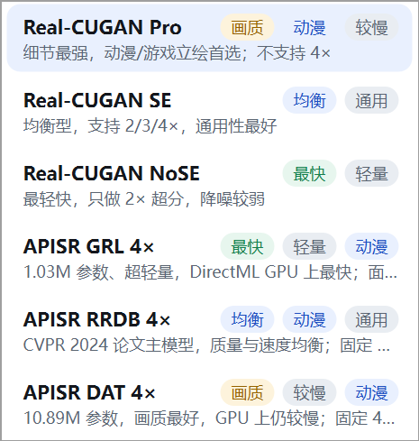

- **模型**：下拉选择，按性能从强到弱排列，每项右侧有彩色标签：
  - `Real-CUGAN Pro`：`画质` `动漫` `较慢` —— 细节最强，支持 2× / 3×，动漫、游戏立绘首选，速度最慢；
  - `Real-CUGAN SE`：`均衡` `通用` —— 支持 2× / 3× / 4×，通用性最好；
  - `Real-CUGAN NoSE`：`最快` `轻量` —— 只做 2×，适合批量快速处理；
  - `APISR GRL`：`最快` `轻量` `动漫` —— 1M 参数的轻量模型，DirectML GPU 上一张 128 瓦片约 0.4 秒，固定 4× 输出；
  - `APISR RRDB`：`均衡` `动漫` `通用` —— CVPR 2024 论文主模型，质量/速度折中，固定 4× 输出；
  - `APISR DAT`：`画质` `较慢` `动漫` —— 10.9M 参数，画质最好但 GPU 上仍较慢，固定 4× 输出。

  标签含义：`画质` = 细节最好但最慢；`均衡` = 画质与速度折中；`最快` = 速度优先；`动漫` = 针对二次元线条/色块调优；`轻量` = 权重小、内存占用低；`较慢` = 单张耗时明显更长。

  > 第一次使用放大功能时右侧只会显示一张「放大模型」卡片，两个包分别下载（带进度条，只需一次）：
  > - `Real-CUGAN 模型` 约 44 MB —— Real-CUGAN 三档共用，走 Vulkan/CPU；
  > - `APISR 模型` 约 59 MB —— APISR 三档共用，走 DirectML GPU（Windows 10/11 自带 DirectML，无需装 CUDA）。
  >
  > 离线或内网环境可以下载 `realcugan-ncnn-models.zip` / `apisr-onnx-models.zip` 后点「从文件安装…」。默认装到 `%LOCALAPPDATA%\ImageForge\models`；把 `models` 文件夹放到 exe 同目录就是便携模式；开发态如果仓库里有 `imgforge/upscale/weights` 会直接用，不需要下载。

  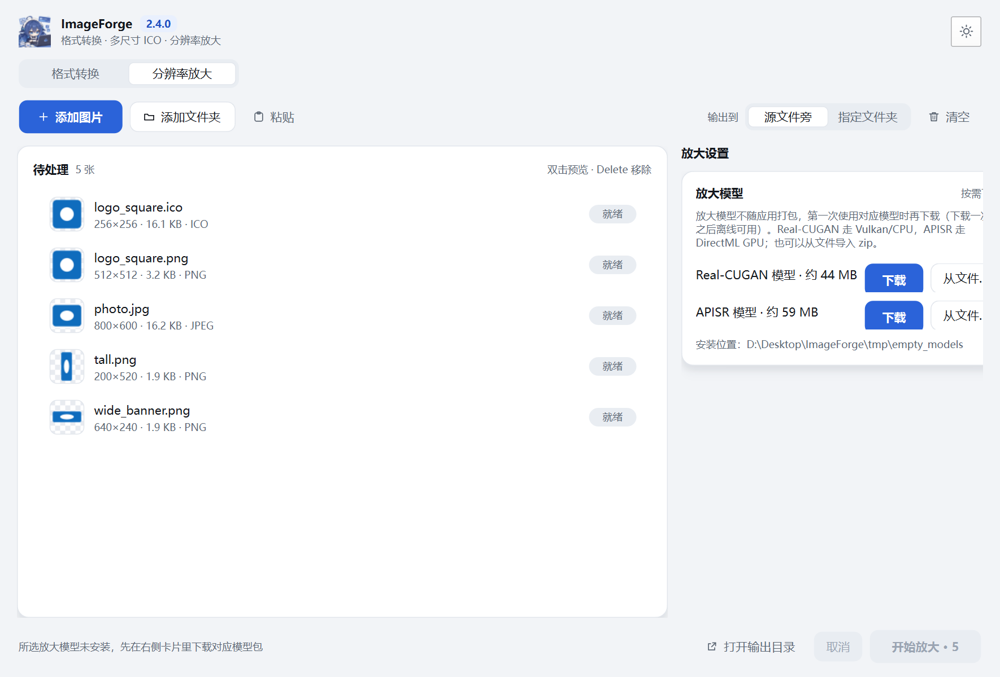
- **设备**：默认 `自动`，优先用 GPU（Real-CUGAN 走 Vulkan，APISR 走 DirectML），显卡不可用时自动回退 CPU；也可以手动锁定 `GPU` / `CPU`。
- **两种放大方式**（互相独立，不是同一件事）：
  - `按倍数`：`1× / 2× / 3× / 4× / 8× / 16× / 32×`。模型单轮最多放 4×，8× 及以上由多轮模型推理组合而成（例如 32× = 4× → 4× → 2×），最后再校正到精确倍率；`1×` 不调用模型，只做重新编码；
  - `按目标尺寸`：720p / 1080p / 2K / 4K / 8K 或自定义宽高；程序按比例把最长边缩放到目标框内，**不会拉伸变形**。
- **降噪**：档位随「模型 + 倍率」变化（保守 / 不降噪 / 轻度 / 中度 / 强降噪），不可用的组合会自动落在最接近的档位，不会崩溃。APISR（ONNX）模型没有降噪档位，这一行会自动隐藏。
- **TTA 增强**：质量略好、速度约慢一倍（仅 Real-CUGAN 支持；APISR 会隐藏该开关）。
- **输出**：默认保持原格式，也可以统一另存为 PNG / JPG / WebP；默认文件名追加 `_upscaled`，不覆盖原图。

> 8× / 16× / 32× 属于「多轮组合放大」：耗时随轮数成倍增加，输出体积也很大。程序会先预估输出尺寸，超过 2.5 亿像素或单边 32768 像素时会直接拒绝并提示降低倍率。

放大完成后，队列行会显示输出尺寸与体积，例如 `400×1040 · 50.5 KB`，路径在「打开输出目录」里。动画图只取第一帧；带透明通道的 PNG 在 CPU 模式下会单独放大 alpha 通道再合并，不会丢透明。

> 速度参考（本机 i5 + 核显）：`200×520` 的 PNG 在 CPU 上 2× 约 6–10 秒，`800×600` 照片约 20–45 秒；GPU 会快很多。放大是计算密集型任务，批量时请耐心等待，右下角进度条会逐张推进。

## 命令行

不想开窗口时可以直接用（命令行不依赖 Qt，装在无图形界面的机器上也能跑）：

```powershell
python -m imgforge formats
python -m imgforge info samples\wide_banner.png
python -m imgforge convert samples -t ico -o out
python -m imgforge convert samples\logo_square.png -t jpg -q 92
```

实际输出：

```text
$ python -m imgforge convert samples -t ico -o tmp\cli_out --sizes 16,24,32,48,64,128,256
源文件           尺寸     输出大小  输出文件         备注
───────────────  ───────  ────────  ───────────────  ────
logo_square.png  256×256  16.1 KB   logo_square.ico  完成
photo.jpg        256×256  18.4 KB   photo.ico        完成
tall.png         256×256  10.6 KB   tall.ico         完成
wide_banner.png  256×256  10.4 KB   wide_banner.ico  完成

全部完成：4 个文件 → ICO（输出到 tmp\cli_out）
```

常用参数：

| 参数 | 说明 |
| --- | --- |
| `-t, --target` | 输出格式，默认 `ico` |
| `-o, --output` | 输出文件夹，默认与源文件同目录 |
| `--sizes` | ICO 尺寸，逗号分隔 |
| `--fit` | 非正方形处理：`contain`（留白）/ `fill`（裁切）/ `stretch`（拉伸） |
| `--payload` | ICO 像素数据：`png`（新系统）或 `bmp`（老系统兼容） |
| `--no-upscale` | 不放大，跳过比源图更大的尺寸 |
| `-q, --quality` | 有损格式质量 1–100 |
| `--lossless` | WebP 无损 |
| `--suffix` / `--overwrite` | 文件名后缀 / 允许覆盖 |
| `--keep-tree` / `--base` | 保留输入目录结构 |
| `--no-recursive` / `--no-metadata` | 不递归 / 不保留 EXIF、ICC |
| `--dry-run` | 只打印计划，不写文件 |

有文件失败时进程返回码为 `1`，方便脚本判断。

程序级参数（`app2.pyw` 与打包后的 `ImageForge.exe` 通用）：

| 参数 | 说明 |
| --- | --- |
| `--check` | 自检：模型包/推理程序是否可用，并真的放大一张 64×64 小图 |
| `--check --require-models` | 同上，但模型未安装时返回失败 |
| `--install-models [ncnn\|apisr\|all]` | 无界面下载模型包（ncnn 约 44 MB / apisr 约 59 MB / 默认 all） |
| `--theme light/dark/system` | 强制主题 |

## 关于 ICO

Windows 图标不是「一张 256×256 的 PNG」那么简单：任务栏、标题栏、文件列表用的尺寸各不相同，系统会按需挑最接近的一档，没有就自己缩——通常比我们预先做好的模糊。

本项目的做法：

- **每个尺寸单独渲染**：LANCZOS 从原图分别缩到 16/24/32/48/64/128/256，而不是从大往小逐级缩；
- **非正方形**：`留白`（透明居中）、`填充裁切`（居中裁掉多余）、`拉伸` 三选一；
- **像素数据**：`PNG 压缩` 体积小、Windows Vista 及以上都认；`BMP 兼容` 是传统 DIB + AND 掩码，兼容老工具，体积大一些；
- **允许放大**：默认关闭时，比源图还大的档位会被跳过（例如 64×64 的源图只出 16/24/32/48/64）。

为什么不用 Pillow 自带的 ICO 保存？它的实现会对帧做 `thumbnail()`，可能产出非正方形帧，并且直接跳过比源图大的尺寸，也没法控制留白方式。所以 `imgforge/ico.py` 自己写了容器编码，并用 Win32 `LoadImage(..., IMAGE_ICON)` 在 16/32/48/256 各档实际加载验证过（PNG 与 BMP 两种载荷都能拿到有效句柄）。

## 支持格式

| 目标 | 扩展名 | 透明 | 动图 | 说明 |
| --- | --- | --- | --- | --- |
| ICO | `.ico` | ✓ | | 图标，多尺寸 |
| PNG | `.png` | ✓ | | 无损，体积中等 |
| JPG | `.jpg` | | | 有损，照片首选 |
| WebP | `.webp` | ✓ | ✓ | 高压缩，可无损 |
| BMP | `.bmp` | | | 无压缩，兼容老系统 |
| TIFF | `.tiff` | ✓ | | LZW 压缩，印刷常用 |
| AVIF | `.avif` | ✓ | | 新格式，压缩率高但较慢 |

输入除了上面这些，还认 `.jpeg .jfif .jpe .dib .tif .tga .ppm .pgm .pbm`。

说明：

- 目标格式不支持透明时（JPG / BMP），透明区域会按设定背景色压平，默认白色；
- 动图转成静态格式时只保留第一帧，并在这行状态里给出提示；
- 动图转 WebP 会保留所有帧；GIF 作为输出格式只在「视频转换」页提供，而且只用于视频。

## 设置保存在哪

`%APPDATA%\ImageForge\settings.json` —— 当前页（转换 / 放大）、主题、输出格式、质量、ICO 选项、放大模型 / 设备 / 倍率 / 目标尺寸 / 降噪、窗口大小、上次目录等。删掉它就恢复默认。

放大模型默认装在 `%LOCALAPPDATA%\ImageForge\models`（约 51 MB 解压后）；可以设置 `IMAGEFORGE_MODELS_DIR` 环境变量指定别的位置，或把 `models` 放在 exe 同目录启用便携模式。

转换产物不会写进程序目录，只有你指定的输出路径。

## 项目结构

```text
ImageForge/
├─ app2.pyw                  2.0 桌面入口（PySide6）
├─ 启动 ImageForge 2.0.bat   2.0 启动器
├─ app.pyw / 启动 ImageForge 1.x.bat   1.x（tkinter）入口
├─ requirements.txt
├─ imgforge/
│  ├─ qt/                    2.0 界面（PySide6）
│  │  ├─ app.py              QApplication、主题、单实例
│  │  ├─ mainwindow.py       主窗口：命令栏 / 队列 / 设置 / 底栏
│  │  ├─ queueview.py        文件队列模型、委托、拖放
│  │  ├─ settings_panel.py   格式转换的输出设置面板
│  │  ├─ video_page.py       视频转换页（队列 / 拖拽 / 进度）
│  │  ├─ video_panel.py      视频设置面板（格式 / 分辨率 / GIF 参数 / 音频）
│  │  ├─ upscale_panel.py    分辨率放大的设置面板（模型下拉 / 设备 / 倍数 / 预设 / 降噪）
│  │  ├─ preview.py          预览窗口与 ICO 尺寸条
│  │  ├─ picker.py           从文件夹挑图
│  │  ├─ tokens.py           颜色 / 间距 / 字号 token
│  │  ├─ theme.py            主题、QSS、明暗切换
│  │  ├─ widgets.py          卡片、胶囊、分段选择、开关、Toast…
│  │  └─ icons.py            矢量图标
│  ├─ video.py               视频探测 / 格式表 / ffmpeg 调度 / 批量转换
│  ├─ upscale/               分辨率放大
│  │  ├─ catalog.py          模型目录（Real-CUGAN 3 档 + APISR ONNX 3 档，性能排序、倍率、降噪档位）
│  │  ├─ targets.py          目标尺寸预设与缩放计算
│  │  ├─ engine.py           ncnn 子进程 / ONNX 推理调度、透明通道、错误翻译、模型路径解析
│  │  ├─ onnx_runner.py      APISR ONNX Runtime（DirectML/CPU）推理、128 瓦片融合
│  │  ├─ download.py         模型包下载 / sha256 校验 / 解压安装（ncnn、apisr 两个包）
│  │  └─ weights/ncnn/       realcugan-ncnn-vulkan.exe 与三套模型权重（源码运行自带；exe 不含）
│  ├─ converter.py           格式表、单文件转换、批量任务
│  ├─ ico.py                 ICO 渲染与容器编码
│  ├─ settings.py            设置读写
│  ├─ version.py             版本号（界面徽标、exe 版本信息共用）
│  ├─ single_instance.py     互斥体 + 激活已开窗口
│  ├─ cli.py                 命令行
│  ├─ __main__.py            模块入口（无参数开 GUI）
│  ├─ gui.py / widgets.py / theme.py / picker.py   1.x tkinter 界面
│  └─ assets/                应用图标与 logo
├─ web/                      零安装 Web 版（纯静态，双击 index.html）
│  ├─ index.html             页面骨架 + 内联 SVG 图标
│  ├─ styles.css             明暗两套语义 token 与组件样式
│  └─ js/                    util / ico / bmp / tiff / zip / convert / app
├─ samples/                  示例图片与示例视频（clip.mp4）
├─ tests/                    201 个单元测试（格式转换 + 挑图 + 单实例 + 设置 + 超分 + ONNX + 模型安装 + 视频）
├─ tools/
│  ├─ make_icon.py           从 assets/logo.png 重新生成 assets/app.ico
│  ├─ check_contrast.py      色板对比度校验
│  ├─ build_exe.py           PyInstaller 打包（默认 Qt 版，--legacy-tk 打 1.x）
│  ├─ entry_qt.py / entry_gui.py        exe 入口脚本
│  ├─ qt_smoke.py            离屏冒烟：添加 → 转换 → 预览 → 挑图
│  ├─ qt_upscale_smoke.py    离屏冒烟：添加 → 切到放大页 → 真实推理一张
│  ├─ qt_models_smoke.py     离屏冒烟：未安装模型 → 安装卡片 → 安装后恢复
│  ├─ qt_video_smoke.py      离屏冒烟：视频页 → 转 GIF → 状态检查
│  ├─ pack_models.py         打包 dist/models/realcugan-ncnn-models.zip 与 apisr-onnx-models.zip
│  ├─ qt_shot.py             真实平台界面截图
│  ├─ shot_window.py         按标题截取任意窗口（含打包后的 exe）
│  ├─ gui_smoke.py / picker_smoke.py   1.x 界面冒烟
│  ├─ web_test.js            Web 版编码器自检（Node，生成 tmp/web/*）
│  ├─ verify_web.py          用 Pillow 解码校验 Web 版产物（21 项）
│  ├─ web_shot.js            用 Chrome DevTools Protocol 给 Web 版截图
│  └─ …
└─ docs/screenshots/
```

## 开发

```powershell
python -m unittest discover -s tests          # 201 个测试
python tools/make_icon.py                     # 从 assets/logo.png 生成多尺寸 app.ico
python tools/check_contrast.py                # 明暗两套色板 WCAG 校验
python tools/qt_smoke.py                      # 离屏跑完整流程
python tools/qt_settings_smoke.py             # 设置改动 → 关窗 → 重新加载是否保留
python tools/qt_upscale_smoke.py              # 离屏冒烟：放大页 + 真实推理
python tools/qt_video_smoke.py                # 离屏冒烟：视频页 → 转 GIF（需要 ffmpeg）
python app2.pyw --check                       # 自检：模型是否存在 + 跑一张 64px 小图
python app2.pyw --install-models              # 无界面下载放大模型（ncnn / apisr / all）
python tools/pack_models.py                   # 打包 ncnn 与 apisr 模型 zip（上传到 models-v1 / models-v2）
python tools/qt_shot.py light tmp\a.png       # 真实窗口截图（dark / --picker / --preview / --convert / --upscale）
python tools/build_exe.py                     # 打包 dist\ImageForge.exe（约 87 MB，模型不含在内）
node tools/web_test.js                        # Web 版编码器自检（Node，无依赖）
python tools/verify_web.py                    # 用 Pillow 校验 Web 版生成的 ICO/BMP/TIFF/ZIP
node tools/web_shot.js "file:///D:/Desktop/ImageForge/web/index.html?demo=1&theme=light" tmp\web.png
```

开发脚本把配置写到 `tmp/settings/`（通过 `IMAGEFORGE_HOME` 环境变量重定向），不会动 `%APPDATA%` 里的真实配置。

## 视频转换

顶部导航切到「视频转换」，页面换成视频队列：左侧待处理列表、右侧视频设置、底栏进度与「开始转换」。


- **输出格式**：MP4 / MKV / MOV / WebM / AVI / GIF。MP4 兼容性最好（H.264 + AAC），WebM 体积小（VP9 + Opus），GIF 是无声音的循环动图，适合贴到聊天、文档或做预览图。
- **画面**：可以保持原始分辨率，或缩到 720p / 1080p / 2K / 4K（只缩小不放大，不会拉伸变形）；GIF 还能设帧率（10–30 fps）、起点与时长、是否循环。
- **体积上限**（仅 GIF）：默认「原画」；选 20 / 10 / 5 / 2 MB 或「自定义」后，程序会按**清晰度优先**自动找档位——先保住分辨率（文字仍然可读），再依次降帧率、降色数，最后才温和缩窄；命中目标体积就停，并在状态提示里告诉你最终参数（例如 `已自动压缩到 18.2 MB（宽 1536 · 6 fps · 64 色）`）。
- **音频**：非 GIF 输出默认保留原音轨；转 GIF 时自动忽略音频并给出提示。
- **输出命名**：自动带上核心参数，一眼看出文件是怎么来的，例如 `clip_gif_1080p_15fps_fit5mb.gif`、`clip_mp4_1080p_q88.mp4`、`clip_webm_1920x1080_q80.webm`；重名仍然自动加 ` (2)`，绝不覆盖源文件。
- **批量**：拖入多个视频或整个文件夹，队列逐条转换，进度条与状态逐张更新；`Esc` 取消，已完成的文件保留。
- 视频探测用 `ffprobe`（缺省时回退 `ffmpeg -i`），缩略图由 ffmpeg 抽第一帧；没有 ffmpeg 时页面顶部会出现安装提示与「重新检测」按钮。

常用命令：

```powershell
winget install Gyan.FFmpeg          # 安装 ffmpeg（只需一次）
python app2.pyw --check             # 自检里会打印 ffmpeg 的实际路径
```

> 视频转换只在界面里提供；命令行目前专注图片（`python -m imgforge`）。输出文件默认放源视频旁边，重名自动编号，绝不覆盖原视频。

### 视频转 GIF 为什么这么大？怎么压小？

GIF 每帧都是独立的 256 色全帧位图（LZW 压缩），**没有帧间运动补偿**；而 H.264 靠运动补偿 + 残差编码，同样画质下可以小 50–100 倍。所以一段 720p@30fps 的视频转成「原画」GIF，几百 MB 是正常现象（每秒 30 帧 × 每帧约 1 MB）。

想压小就用视频页的**体积上限**：选 5 MB / 10 MB 等档位，程序会按「清晰度优先」自动找档位——先把分辨率顶到能装下的最大宽度（文字尽量可读），再依次降帧率（15 → 12 → 10 → 8 → 6 → 5 → 4 fps）和色数（64 → 32），实在不行才按 90% / 85% / … 温和缩窄。为了同样的体积更清晰，它还做了三件事：

- **去重复帧**（`mpdecimate`）：讲解/录屏类视频里大量静止画面会被合并，体积能省 30–60%，播放节奏不变；
- **轻量去噪**（`hqdn3d`）：实拍或生成视频里的颗粒噪点在调色板量化后会碎成大量色块，是 GIF 体积最大的隐形来源，去噪后同样清晰度下体积小 25–35%；
- **样片预测**：先编 2.5 秒样片（取全片 35% 处）估算各档体积，直接从最可能的档位开始，通常 2–3 次试编码（几十秒）就能命中，而不是把十几档全编一遍。

实测参考（1920×1080、18 秒、30 fps 的讲解视频，目标 20 MB）：

| 目标 | 结果 | 体积 | 耗时 |
| --- | --- | --- | --- |
| 20 MB（清晰优先） | 1536×864 · 6 fps · 64 色 | 18.2 MB | 24 秒 |
| 20 MB（更流畅） | 1280×720 · 10 fps · 64 色 | 18.2 MB | 9 秒 |
| 原画不限 | 1920×1080 · 30 fps · 256 色 | 数百 MB | 分钟级 |

> 想要又清晰又流畅，GIF 不是好容器：同样内容转 **WebP 动图 / MP4** 体积能小 5–10 倍；或者把片段截短（视频页的「时长」），体积会按秒数线性下降。

## Web 版

`web/` 是零依赖、零构建的静态版本：不需要 Python、不需要安装、不联网，转换全部在浏览器里用 File API + Canvas 完成，文件不会离开本机。

- 支持 **PNG / JPG / WebP / BMP / TIFF / AVIF** 互转，以及**多尺寸 ICO 生成**（16 / 24 / 32 / 48 / 64 / 128 / 256 七档，PNG 或 BMP 载荷）；
- 编码器全部手写：ICO 容器（PNG + DIB + 1bpp AND 掩码）、BMP（24/32 位、自底向上）、未压缩小端 TIFF、store 模式 ZIP（UTF-8 文件名 + CRC32）；
- 交互与桌面版一致：拖拽 / 文件夹递归 / 粘贴、队列、格式胶囊、尺寸复选、非正方形处理、像素数据、质量滑条、背景色、文件名后缀、命名预览、预览弹窗（含 ICO 每一档真实渲染）、明暗主题；
- 批量：全部转换完后「全部下载 (zip)」一次打包。

```powershell
# 直接双击
web\index.html

# 或者起一个本地静态服务器（可选）
python -m http.server 8000 --directory web
```

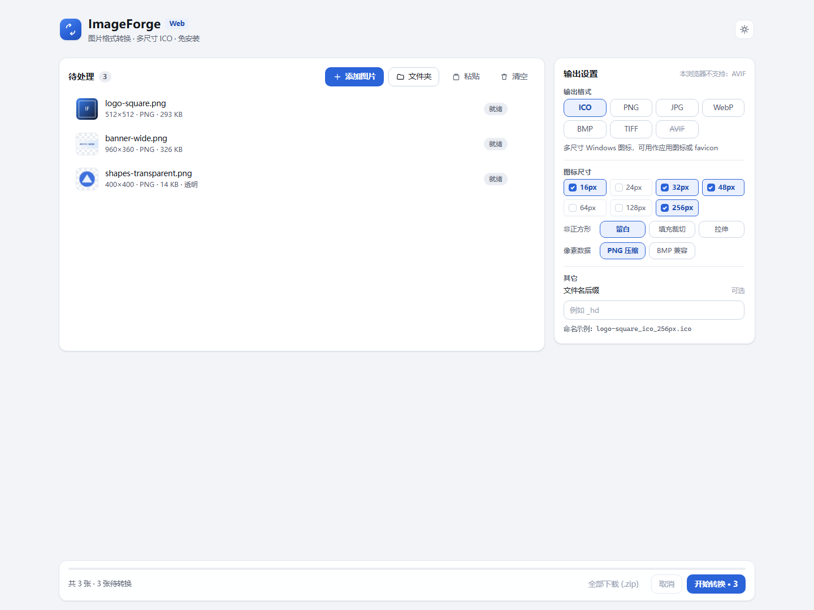

<details>
<summary>Web 深色、转换完成、预览弹窗（点击展开）</summary>

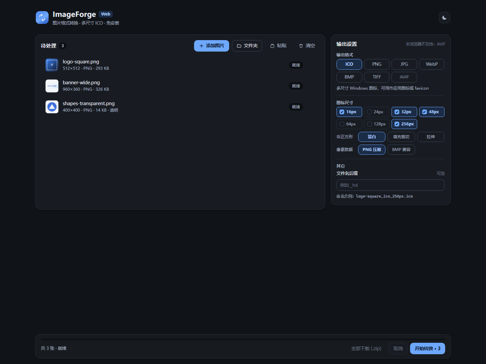

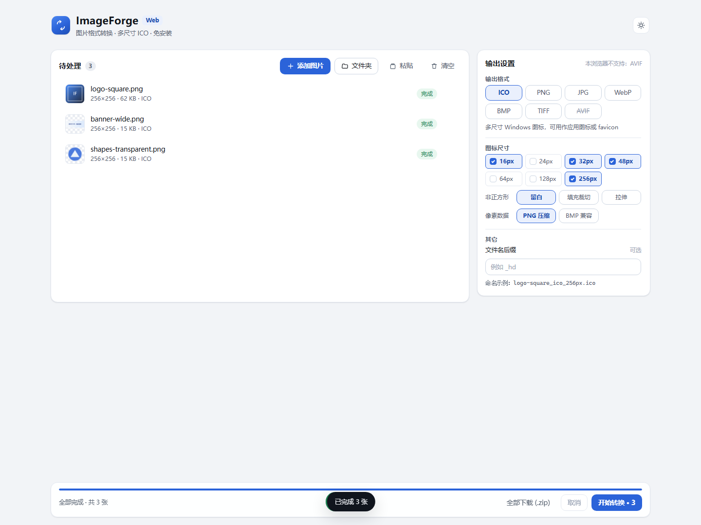

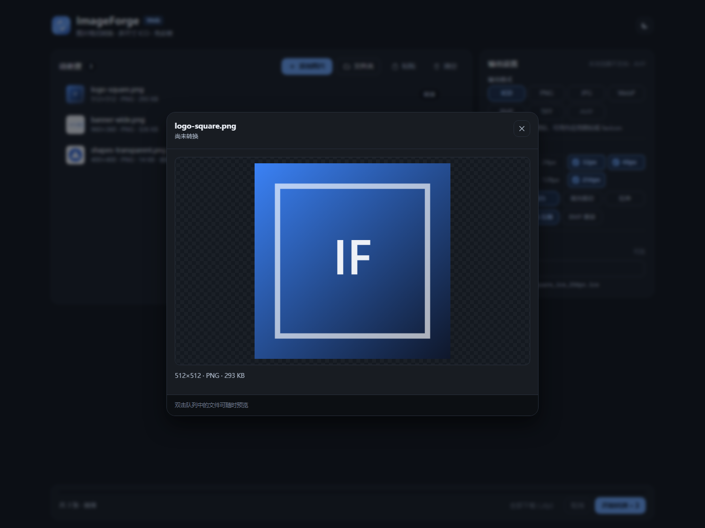

</details>

> WebP / AVIF 的**编码**支持取决于浏览器：Chrome / Edge 两种都支持，Firefox 支持 WebP 但不支持 AVIF 编码。不支持的格式会在设置里标灰并提示；桌面版没有这个限制。

## 更新日志

### 2.7.0

- 新增**零安装 Web 版**（`web/`）：图片格式互转 + 多尺寸 ICO，自研 ICO / BMP / TIFF / ZIP 编码器，浏览器本地处理，明暗主题、拖拽 / 粘贴 / 文件夹递归、预览与批量 ZIP 下载。
- 新增 `tools/web_test.js`（Node 编码自检）、`tools/verify_web.py`（Pillow 解码校验 21 项）、`tools/web_shot.js`（CDP 截图）。
- 桌面版无功能变化。

### 2.6.1

- 视频转 GIF 的体积上限算法重写为**清晰度优先**：先保分辨率，再降帧率 / 色数，最后才缩宽；新增去重复帧、轻量去噪与样片预测，同样 20 MB 上限下，1080p 18 秒素材从「730×410 · 10 fps · 64 色」提升到「1536×864 · 6 fps · 64 色」，耗时从 210 秒降到 24 秒。
- 自动压缩后的文件名改为写**实际生效**的宽高与帧率（如 `masked-views_gif_1536x864_6fps_fit20mb.gif`），不再出现「名字写 30fps、实际 6fps」。
- 测试数 198 → 201。

### 2.6.0

- 顶部导航改名为「图片转换 / 视频转换 / 分辨率放大」，「视频转换」排到第 2 位。
- 视频转 GIF 新增**体积上限**（原画 / 20 MB / 10 MB / 5 MB / 2 MB / 自定义）：自动降帧、降宽、降色数，逐档试编码直到压进目标体积。
- 输出文件命名自动带上核心参数（如 `clip_gif_1080p_15fps_fit5mb.gif`、`clip_mp4_1080p_q88.mp4`、`logo_icon_ico_32px.ico`、`tall_2x_cugan-se.png`），不再只是改后缀。
- 进度条改成从左到右累积填充（6px 高，进度很小时也可见），状态栏补充百分比。
- 版本号 2.6.0。

### 2.5.0

- 图片页去掉「输出 GIF」：图片格式互转只负责静态图（PNG / JPG / WebP / BMP / TIFF / AVIF / ICO），动图请走视频页。GIF 作为输入仍然支持。
- 新增「视频转换」页：MP4 / MKV / MOV / WebM / AVI / GIF 互转，支持分辨率、帧率、片段截取、音频开关与循环 GIF。
- 新增 `imgforge/video.py`（ffprobe 探测、ffmpeg 编码、批量与取消）与 37 个视频单元测试，测试总数 190。
- 顶部导航变三页（图片转换 / 视频转换 / 分辨率放大），切换时保留各自队列和设置；视频页有独立的进度条与开始按钮。
- 新增 `tools/qt_video_smoke.py` 离屏冒烟；`--check` 自检增加 ffmpeg 路径。
- 版本号 2.5.0。

### 2.4.0

- 新增 **APISR 三档模型**（GRL / RRDB / DAT），通过 ONNX Runtime + **DirectML** 跑在核显/独显上，不需要 CUDA 也不需要 torch；面向动漫截图与游戏立绘，GPU 上比 CPU 快 5–9 倍。
- 模型包拆成两个：Real-CUGAN（ncnn，约 44 MB，Vulkan/CPU）与 APISR（ONNX，约 59 MB，DirectML GPU），安装卡分别显示、可单独下载或本地导入；只装了 Real-CUGAN 时选 APISR 会提示先下载，开始按钮同步禁用。
- 模型下拉共 6 档，每档带彩色标签（画质 / 动漫 / 均衡 / 最快 / 轻量 / 较慢）；APISR 模型固定 4× 输出，选其它倍率会提示「先在 4× 放大后缩放回目标尺寸」，并自动隐藏不适用的降噪与 TTA 选项。
- exe 内置 ONNX Runtime，体积约 87 MB（模型仍不打包）；`--check` 会分别报告两个模型包与 ONNX 运行后端，`--install-models ncnn|apisr|all` 可单独下载。
- 新增 `imgforge/upscale/onnx_runner.py`（128 瓦片重叠融合、会话缓存、透明通道 alpha 单独放大）与 37 个 ONNX 测试 + 28 个模型包测试，测试总数 152。

### 2.3.0

- 超分模型从 exe 中拆出，改为首次使用时按需下载（约 44 MB，带进度条与 sha256 校验），也支持从本地 zip 离线安装；exe 从约 100 MB 降到约 52 MB。
- 模型下拉框每项右侧新增彩色短标签（画质 / 动漫 / 较慢 / 均衡 / 通用 / 最快 / 轻量），一眼就能挑模型；说明文字与标签含义写进了 README 与 FAQ。
- 未安装模型时放大页只显示「放大模型」卡片（下载模型 / 从文件安装），开始按钮禁用并在状态栏提示；安装后四张设置卡自动恢复。
- 新增 `--install-models`（无界面下载）与 `--check --require-models`（模型缺失视为失败）；`--check` 在模型未安装时给出友好提示而不是报错。
- 新增 9 个模型定位 / 安装 / 校验测试与 `tools/qt_models_smoke.py`，测试总数 96。

### 2.2.0

- 模型选择从一排胶囊改为下拉框，面板更省高度，模型多了也放得下。
- 放大倍数扩展到 `1× / 2× / 3× / 4× / 8× / 16× / 32×`：8× 及以上由多轮模型推理组合（如 32× = 4× → 4× → 2×），再校正到精确尺寸；`1×` 只重新编码不调用模型。
- 新增输出尺寸护栏：预计超过 2.5 亿像素或单边 32768 像素时直接给出中文提示，避免吃满内存。
- 新增 7 个多轮放大 / 护栏 / 1× 直通单元测试，测试总数 87。

### 2.1.0

- 新增「分辨率放大」页：顶部导航在「格式转换 / 分辨率放大」之间切换，两页共用同一个待处理队列、拖拽、挑图与快捷键。
- 集成 Real-CUGAN（ncnn/Vulkan）超分：`Pro` / `SE` / `NoSE` 三档模型按性能排序，支持 2× / 3× / 4× 与 720p / 1080p / 2K / 4K / 8K / 自定义目标尺寸两种放大方式。
- 设备默认 `自动`（优先 GPU，失败回退 CPU），也可手动指定 GPU / CPU；降噪档位按「模型 + 倍率」自动取可用值。
- 超分引擎单独成包 `imgforge/upscale/`，不依赖 torch / numpy / OpenCV；CPU 模式自动处理透明通道，崩溃组合会自动回退并给出中文提示。
- 新增 38 个超分单元测试（含真实 CPU 推理冒烟）与 `tools/qt_upscale_smoke.py`，测试总数 80。
- exe 体积从 52 MB 增至约 100 MB（51 MB 为模型权重），版本号 2.1.0。

### 2.0.1

- 设置面板的改动（格式、尺寸、质量、ICO 细节、其它开关）现在会在 350 ms 去抖后立即落盘，关窗时再存一次；不再依赖“正常退出才会写文件”。
- 版本号改为由 `imgforge/version.py` 统一提供，界面徽标、exe 属性、打包脚本共用同一个值。
- 新增 7 个设置读写单元测试与 `tools/qt_settings_smoke.py`（改设置 → 关窗 → 重启校验）。

### 2.0.0

- 界面从 tkinter 重写为 PySide6（Qt 6）：卡片式布局、明暗双主题、1.5× 高 DPI 下清晰。
- 新增命令栏、输出到「源文件旁 / 指定文件夹」分段控件、状态胶囊、Toast 提示。
- 预览窗口支持查看 ICO 每一档尺寸的真实渲染结果。
- 从文件夹挑图窗口重做：搜索、全选/连选、已在列表标记、缩略图异步加载。
- 单实例、拖拽、快捷键与 1.x 保持一致；转换引擎不变。

### 1.0.0

- tkinter 版本，见标签 `v1.0.0`。

## 常见问题

**转成 JPG 后透明背景变白了？** JPG 不支持透明，透明区域会按背景色压平，这是预期行为。要保留透明就选 PNG / WebP / AVIF。

**输出的文件名多了 ` (2)`？** 避免覆盖已有文件。源文件和输出同名时也会自动改成 `名字_格式.扩展名`。

**拖拽没反应？** 2.0 的拖拽由 Qt 直接处理，不依赖额外组件。如果确实没反应，用工具栏的「添加图片」「选择文件夹…」一样可以。

**双击 exe 时 Windows 提示"已保护你的电脑"？** 程序没有代码签名，首次运行会触发 SmartScreen。点「更多信息」→「仍要运行」即可；也可以右键 exe → 属性 → 常规 → 勾选「解除锁定」。

**已经开着一个窗口，再双击好像没反应？** 这是单实例行为：新进程会把已经开着的窗口提到前台，然后自己退出，避免开出一堆重复窗口。

**挑图时有些行是灰的、右边写着「已在列表」？** 这些图已经在待处理队列里了，重复勾选不会重复添加。

**放大很慢，正常吗？** 正常。超分是逐像素推理，CPU 上 `800×600` 的照片大约 20–45 秒，`200×520` 的插画约 6–10 秒；Real-CUGAN 走 GPU（Vulkan）、APISR 走 GPU（DirectML）会快数倍。批量处理时进度条会逐张推进。

**提示「CPU 模式不可用，已改用 GPU」？** 说明当前模型/图片组合在 CPU 上推理失败，程序自动改用 GPU 重试，结果不受影响；这条只是一行提示。

**六个模型怎么选？** 看下拉框里的彩色标签即可：要细节 → `画质`（Real-CUGAN Pro 或 APISR DAT）；要速度 → `最快`（NoSE 或 APISR GRL）；拿不准 → `均衡`（SE 或 APISR RRDB）。动漫 / 游戏截图优先带 `动漫` 标签的 APISR（对线条和色块更友好，DAT 画质最好、GRL 最快）；普通照片或想稳一点用 Real-CUGAN SE；只是先放大尺寸、后面还要处理就用 NoSE / GRL。

**APISR 是不是不如 Real-CUGAN？** 不是。APISR（CVPR 2024）面向「真实退化」的动画截图复原（模糊、压缩噪点、轻中度瑕疵），GRL 极轻、DAT 画质最高，很多场景确实强于 Real-CUGAN。2.4.0 已内置 APISR 三档：模型导出为 ONNX，用 **DirectML** 在 GPU 上推理，不需要 CUDA、也不带 torch（权重 59 MB，按需下载），所以不会出现「装 APISR 就要 1.5–2 GB torch」的问题。

**为什么 ImageForge-SR.exe 只有 8 MB，却能跑 18 个模型？** 因为那个 exe 不含模型也不含 torch：它依赖本机已经装好的 Python + PyTorch，运行时再到 `weights/` 目录读权重。所以它「轻」的前提是机器上已经有约 1.5 GB 的 Python 环境；本项目的 exe 是自包含的（不要求装 Python），模型单独按需下载。

**模型下载失败 / 公司网络下不了怎么办？** 手动下载 [Real-CUGAN 模型包](https://github.com/kuangdang123/ImageForge/releases/tag/models-v1) 或 [APISR 模型包](https://github.com/kuangdang123/ImageForge/releases/tag/models-v2)，在放大页点「从文件安装…」选择 zip；也可以命令行 `ImageForge.exe --install-models ncnn` / `ImageForge.exe --install-models apisr`（自动校验 sha256）。

**8× / 16× / 32× 是怎么实现的？** Real-CUGAN 单轮最多 4×，更高倍率由多轮模型推理串联（例如 32× = 4× → 4× → 2×），最后再校正到精确尺寸。倍率越高耗时约成倍增长，输出文件也越大；预计超过 2.5 亿像素或单边 32768 像素时程序会直接拒绝并提示。`1×` 不调用模型，只做格式转换。

**放大后透明背景会不会变黑？** 不会。带 alpha 的 PNG 在 CPU 模式下会把透明通道单独放大再合并，输出仍是透明 PNG（输出格式选 PNG / WebP 时）。

**怎么确认超分功能是好的？** 命令行运行 `python app2.pyw --check`（打包版直接 `ImageForge.exe --check`），它会检查模型并真的放大一张 64×64 小图，最后一行是 `result: OK`；模型没装时显示 `OK (未安装模型)` 并给出安装提示，加上 `--require-models` 则视为失败；打包版没有控制台，同样的内容写在 `%TEMP%\\ImageForge-selftest.txt`。

**放大后的文件在哪？** 与转换页一致：默认放源文件旁边，也可以在「保存到」里指定文件夹；文件名默认追加 `_upscaled`，永远不会覆盖原图。

**设置会保存吗？** 会。输出格式、质量、ICO 尺寸与细节、其它开关、主题、窗口大小、上次目录都写在 `%APPDATA%\ImageForge\settings.json`，下次启动自动恢复；改完 0.35 秒就在后台落盘，即使直接关进程也不会丢。

**动图不动了？** 图片页只有 WebP 作为输出格式支持动图，其它图片格式只取第一帧；要把视频转成 GIF 请用「视频转换」页。

**为什么 AVIF 慢？** 编码本身计算量大，批量时耐心等一下；急着用可以先转 WebP。

**图片页为什么没有 GIF 输出了？** 图片格式互转现在只做静态图，GIF 动图交给「视频转换」页（视频 → GIF 更常见，也能设帧率和循环）；GIF 仍然可以作为输入，转成 PNG / WebP 等格式。

**视频转换提示找不到 ffmpeg？** 视频相关功能依赖系统里的 ffmpeg：`winget install Gyan.FFmpeg` 装好后点视频页的「重新检测」；也可以用 `IMAGEFORGE_FFMPEG` 环境变量指定 `ffmpeg.exe` 的完整路径。`python app2.pyw --check` 会打印当前识别到的 ffmpeg 路径。

**视频转 GIF 很慢 / 文件很大？** GIF 是 256 色调色板格式，长视频转 GIF 体积会明显膨胀。建议先把「起点 / 时长」截短，帧率降到 12–15，分辨率缩到 720p 以内。

**exe 为什么是 87 MB？** 主要是 PySide6 的 Qt 运行库 + ONNX Runtime（DirectML 推理，已排除 WebEngine、QML、3D 等模块）；模型仍然不打进 exe，首次使用放大功能时再按包下载（Real-CUGAN 45.9 MB / APISR 59 MB）。1.x 的 tkinter 版本只有 23 MB。

**模型装在哪？能换位置吗？** 默认 `%LOCALAPPDATA%\ImageForge\models`。设置环境变量 `IMAGEFORGE_MODELS_DIR` 可指定任意目录（只认这个位置，不会偷偷回退）；把 `models` 文件夹放到 exe 同目录则是便携模式，整个文件夹拷走即可。
